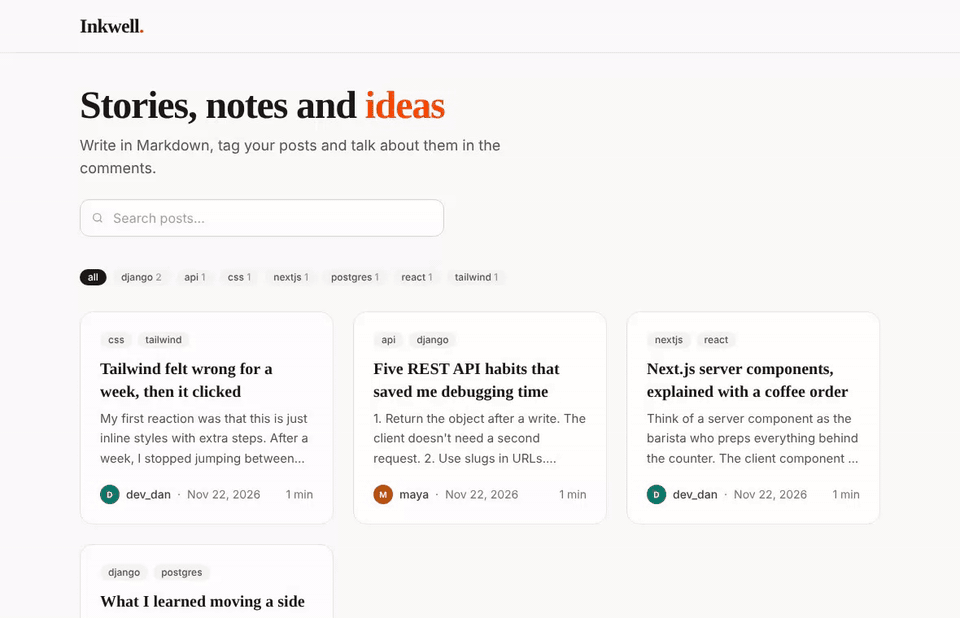
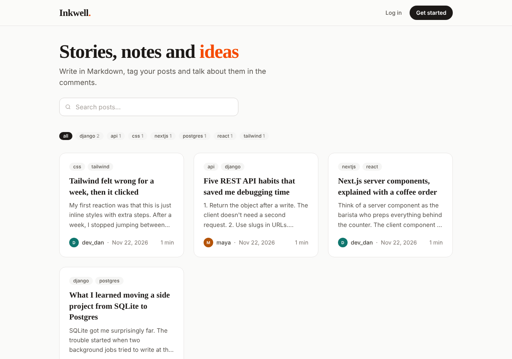
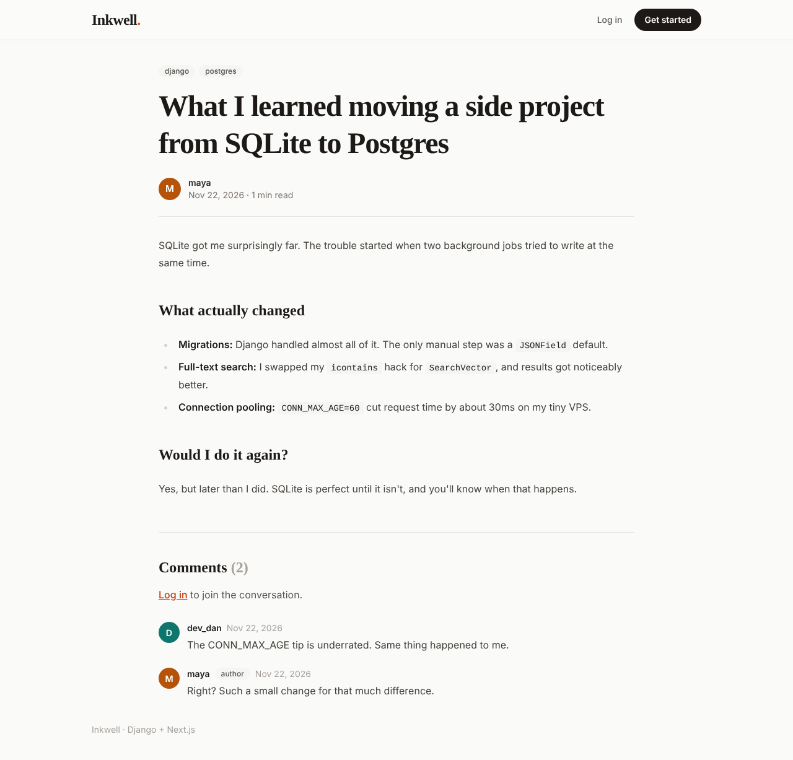
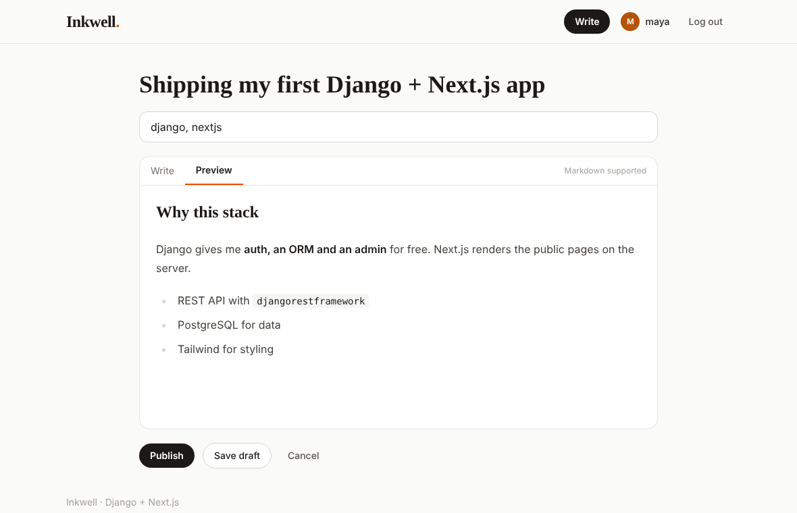

# Inkwell: a full-stack blog

A blogging platform with accounts, Markdown posts, drafts, tags, search and comments.
The backend is a **Django REST Framework** API on **PostgreSQL**. The frontend is **Next.js** (App Router, TypeScript) styled with **Tailwind CSS**.




| Home | Post | Editor |
|---|---|---|
|  |  |  |

## Features

- **Accounts:** register and log in with JWT access/refresh tokens. Expired access tokens refresh silently.
- **Markdown posts:** a write/preview editor, GitHub-flavoured Markdown, and code blocks.
- **Drafts:** save privately and publish later. Drafts are only visible to their author.
- **Tags, search and author pages:** filter the feed by tag or author, or search titles and post text.
- **Comments:** readers can comment, and the commenter or the post's author can delete a comment.
- **Permissions:** only the author can edit or delete a post. This is enforced in the API, not just hidden in the UI.
- **Server-rendered public pages** (home and posts) for fast first loads and proper page titles.
- **Django admin** for managing posts, tags and comments.
- Pagination, unique slugs, reading time, excerpts, and a mobile-friendly layout.

## Architecture

```
Next.js (3000)                                   Django + DRF (8000)          PostgreSQL
├─ Server components ── fetch ────────────────▶  /api/posts, /api/tags   ──▶  posts, tags,
│   (home, post pages)                           /api/posts/{slug}            comments, users
└─ Client components ── /api/* (Next rewrite) ─▶ /api/auth/*  (JWT)
    (editor, comments, auth)                     /api/comments/{id}
```

The browser only ever talks to the Next.js origin. `/api/*` is rewritten to Django, so no CORS setup is needed.

### API

| Method | Endpoint | Auth | Notes |
|---|---|---|---|
| POST | `/api/auth/register` | none | `username`, `password`, optional `email` |
| POST | `/api/auth/token` | none | returns `access` and `refresh` |
| POST | `/api/auth/token/refresh` | none | |
| GET | `/api/auth/me` | required | current user |
| GET | `/api/posts` | none | published posts, paginated; `?search=`, `?tag=`, `?author=`; `?mine=true` includes your drafts |
| POST | `/api/posts` | required | `title`, `body`, `status`, `tag_names[]` (max 5) |
| GET / PATCH / DELETE | `/api/posts/{slug}` | author only for writes | |
| GET / POST | `/api/posts/{slug}/comments` | required to post | |
| DELETE | `/api/comments/{id}` | commenter or post author | |
| GET | `/api/tags` | none | tags with published post counts |

## Running locally

**1. Database:** any PostgreSQL 14+ works. With Docker:

```bash
docker run -d --name blog-db -e POSTGRES_PASSWORD=postgres -e POSTGRES_DB=blog -p 5432:5432 postgres:16
```

**2. Backend**

```bash
cd backend
python -m venv .venv && source .venv/bin/activate   # Windows: .venv\Scripts\activate
pip install -r requirements.txt
cp .env.example .env                                # adjust DATABASE_URL if needed
python manage.py migrate
python manage.py seed_demo        # optional sample posts; log in as maya / demo-pass-123
python manage.py createsuperuser  # optional, for /admin
python manage.py runserver
```

**3. Frontend**

```bash
cd frontend
npm install
npm run dev
```

Open http://localhost:3000.

### Or run everything with Docker Compose

```bash
docker compose up --build
docker compose exec backend python manage.py seed_demo   # optional sample data
```

This starts Postgres, the Django API (behind gunicorn) and the Next.js production server.

## Tests

```bash
# API: 15 tests covering auth, permissions, drafts, search, tags and comments (needs Postgres)
cd backend && pip install -r requirements-dev.txt && pytest

# Browser: register, write and preview, search, tags, comments, edit, drafts, delete
pip install playwright && playwright install chromium
python e2e/blog_flow.py http://localhost:3000
```

CI runs the API tests against a Postgres service container, then lints and builds the frontend, then runs the browser test.

## Project structure

```
backend/
  config/            settings, URLs
  blog/models.py     Post, Tag, Comment
  blog/serializers.py
  blog/views.py      viewsets, permissions, query filtering
  blog/tests/        pytest-django API tests
frontend/src/
  app/               routes: /, /posts/[slug], /posts/[slug]/edit, /write, /me, /login, /register
  components/        PostCard, PostEditor, PostView, Comments, Markdown, ...
  lib/               API clients (server + browser), auth context, types
e2e/blog_flow.py     Playwright end-to-end test
docker-compose.yml
```

## History

v1 was a small React + Firebase app with Google sign-in. v2 rewrites it as a separate Django API and Next.js frontend, and adds drafts, Markdown, tags, search, comments and tests.

## License

MIT
